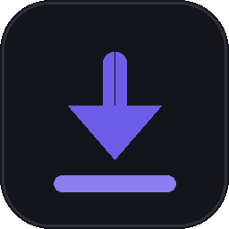
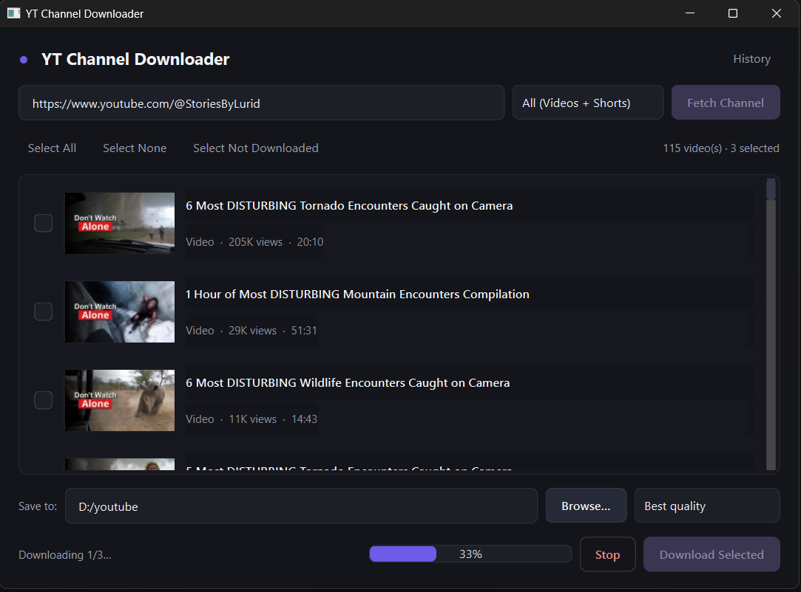

<div align="center">



# YT Channel Downloader

A modern desktop app for browsing a YouTube channel's Videos and Shorts,
previewing them (thumbnail, title, view count, duration), and downloading
exactly the ones you want — with a persistent history and full control
over quality and save location.

Built with **PySide6** and **yt-dlp**.

[](https://www.python.org/)
[](https://doc.qt.io/qtforpython/)
[](https://github.com/yt-dlp/yt-dlp)
[](LICENSE)
[](https://github.com/Sewer2K)



</div>

---

## Features

- 🔗 Paste a full channel URL **or** just an `@handle`
- 🎛️ Choose **Videos**, **Shorts**, or **All**
- 🖼️ Every result shows a **thumbnail, title, view count, and duration**,
  populated progressively as they're found — no waiting on a full channel
  scan before you see anything
- ✅ Tick individual videos, or use **Select All / Select None / Select Not
  Downloaded**
- 🎚️ Choose quality: **Best**, **1080p max**, **720p max**, or
  **Audio-only (MP3)**
- 📁 Pick your download folder — remembered between sessions
- 🏷️ Files are saved using the **actual video title** as the filename
- 🕘 A built-in **History** window tracks every completed download
  (title, channel, size, date) and can jump straight to the file's folder
- ✔️ Previously downloaded videos are flagged in the list so you never
  double-download by accident
- ⚡ Fully responsive UI — fetching and downloading run on background
  threads and never freeze the window, even on very large channels
- 🖥️ Clean, modern dark interface

## Getting Started

### Prerequisites

- **Python 3.10+**
- **[FFmpeg](https://ffmpeg.org/download.html)** on your `PATH` — required
  by yt-dlp to merge separate video/audio streams and to extract MP3 audio.
  - Windows: `winget install ffmpeg`, or download a static build and add
    its `bin` folder to `PATH`.
  - macOS: `brew install ffmpeg`
  - Linux: `sudo apt install ffmpeg` (or your distro's package manager)

### Run from source

```bash
git clone https://github.com/Sewer2K/yt-channel-downloader.git
cd yt-channel-downloader
pip install -r requirements.txt
python main.py
```

### Build a standalone executable

```bash
pip install -r requirements.txt
python build.py
```

This produces a single-file executable — `dist/YTChannelDownloader.exe` on
Windows, or `dist/YTChannelDownloader` on macOS/Linux — with the app icon
already baked in. No Python installation needed on the machine you run it
on.

> **Note:** FFmpeg is *not* bundled into the executable. Either make sure
> it's on the target machine's `PATH`, or drop `ffmpeg.exe` next to the
> built executable — yt-dlp checks there too.

## How it works

The app asks yt-dlp for a **flat extraction** of a channel's `/videos`
and/or `/shorts` tab. YouTube's channel page already embeds title, view
count, duration, and thumbnail URLs for every video listed there, so this
returns full metadata for the whole channel **without a separate request
per video** — which is what keeps even very large channels fast to browse.

Downloads run on a background `QThread`, streaming per-item progress (and
an overall progress bar) back to the UI via Qt signals, so the interface
stays responsive throughout.

## Where data is stored

The history database and thumbnail cache live outside the app/install
folder so they survive updates and reinstalls:

| OS      | Location                                              |
|---------|--------------------------------------------------------|
| Windows | `%APPDATA%\YTChannelDownloader\`                       |
| macOS   | `~/Library/Application Support/YTChannelDownloader/`   |
| Linux   | `~/.local/share/YTChannelDownloader/`                  |

Your last-used output folder, channel, and quality setting are saved via
Qt's native settings store (registry on Windows, plist on macOS, a config
file on Linux).

## Project layout

```
main.py                   Entry point — creates the QApplication and window
build.py                  PyInstaller build script
requirements.txt

ytchdl/
├── main_window.py         Main window: layout + all UI wiring
├── workers.py              Background QThreads: FetchWorker, DownloadWorker
├── thumbnails.py           Async thumbnail loading with a disk cache
├── history.py              SQLite-backed download history
├── history_dialog.py       The "Download History" window
├── video_row.py            Custom row widget (checkbox/thumbnail/progress)
├── styles.py                The app's QSS dark theme
├── utils.py                Filename sanitizing, formatting, path helpers
└── assets/                  App icon + UI icons

docs/
└── screenshot.png          README screenshot
```

## Troubleshooting

| Problem | Fix |
|---|---|
| "No videos found" | Double-check the URL/handle, and that the channel actually has content in that tab (some channels have no Shorts). |
| Downloads finish with no audio, or merging fails | Install FFmpeg and make sure it's on `PATH`. |
| Built exe throws `ModuleNotFoundError` at runtime | Re-run `python build.py`. If it persists for a specific package, add `--collect-all=<package>` to the args list in `build.py`. |

## Contributing

Issues and pull requests are welcome. If you're proposing a larger change,
please open an issue first to discuss what you'd like to change.

## License

Released under the [MIT License](LICENSE).

## Author

**Sewer2K** — [github.com/Sewer2K](https://github.com/Sewer2K)
